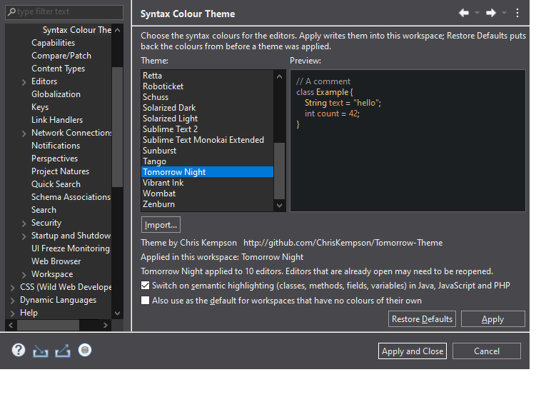
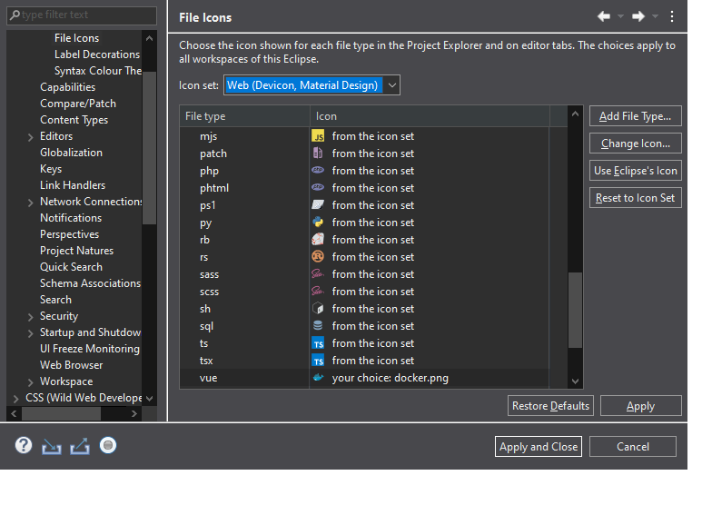

# Eclipse addons: Syntax Colour Themes for Web, File Icons for Web

Two independent Eclipse plug-ins in one project folder. Each can be installed without the other.

| Plug-in | Bundle id | Preference page |
|---|---|---|
| Syntax Colour Themes for Web | `io.github.jollygood1.syntaxthemes` | General > Appearance > Syntax Colour Theme |
| File Icons for Web | `io.github.jollygood1.fileicons` | General > Appearance > File Icons |

The first part of this file is about the colour themes; File Icons has its own section further down. Build and Install are the same for both.

# Syntax Colour Themes for Web

Adds **Window > Preferences > General > Appearance > Syntax Colour Theme**: pick a colour theme, press Apply, and the syntax colours of the installed editors are set for the current workspace.

It ships with 27 themes: the 26 themes of the Eclipse Color Theme plug-in (Black Pastel, frontenddev, Gedit Original Oblivion, Havenjark, Inkpot, minimal, Monokai, Mr, NightLion Aptana Theme, Notepad++ Like, Oblivion, Obsidian, Pastel, RecognEyes, Retta, Roboticket, Schuss, Solarized Dark, Solarized Light, Sublime Text 2, Sublime Text Monokai Extended, Sunburst, Tango, Vibrant Ink, Wombat, Zenburn) and Tomorrow Night because it's my favourite. Eclipse itself has no theme files of this kind; its own colours are what **Restore Defaults** returns to.

Built and tested on 2026-11-10 with Eclipse IDE 4.41 (2026-09) for PHP Developers, Windows 10. Bundle id: `io.github.jollygood1.syntaxthemes`.



## What Apply does

- Writes the theme's colours into the preference nodes of the editors that are installed: text editors in general (`org.eclipse.ui.editors`), Java, JavaScript (JSDT), PHP (incl. semantic highlighting), Twig, JSP, HTML, CSS, XML, XSL, DTD and the WST JSON editor. Editors that are not installed are skipped.
- Selects the matching TextMate theme for the Generic Code Editor (TM4E: Vue, TypeScript, YAML, SCSS ...). Tomorrow Night brings a hand-made one. For every other theme, bundled or imported without a TextMate file, one is generated from the palette (`TextMateGenerator`) and written to `<Eclipse>\configuration\io.github.jollygood1.syntaxthemes\textmate`. It is set as TM4E's default for both dark and light window themes, so the Generic Code Editor follows the chosen theme whatever the window theme is.
- Applies the bold, italic, underline and strikethrough settings a theme states (six of the bundled themes have some): inside the value for PHP and the web editors, as separate keys for Java and JavaScript and for semantic highlighting, and as font styles in the generated TextMate theme. Where a theme says nothing about a style, the editor's own default stays.
- With *Switch on semantic highlighting...* ticked, also switches on every semantic highlight (classes, methods, fields, variables in Java, JavaScript and PHP) the theme has a colour for. Eclipse has some of them off by default, and then their colour does not show. Unticked (the default), each highlight stays on or off as it was.
- Saves the previous value of every key it changes. **Restore Defaults** on the page puts those back. Switching to another theme first restores, then applies, so nothing of the earlier theme is left behind.
- Works per workspace. Tick *Also use as the default...* to write the same values install-wide (`<Eclipse>\configuration\.settings`) for workspaces that have no colours of their own. Restore Defaults does not undo that install-wide copy.
- OK applies only when you picked a different theme; Apply always writes the selected theme again. Editors that are already open may need to be reopened.
- PHP `public` / `private` / `protected` keyword colours are not touched.
- Switching the window theme (General > Appearance, Light/Dark) while Eclipse runs makes Eclipse overwrite editor colours with the window theme's own. The addon listens for that switch and writes the chosen colour theme again.

## Build

There are two ways to build. Both need a JDK 21.

### With Maven and Tycho (plug-ins, features and an update site)

Needs Maven 3.9.9 or newer and, on the first run, an internet connection: Tycho and the list of Eclipse plug-ins to compile against are downloaded from Maven Central and `download.eclipse.org` into the local Maven repository. No Eclipse install is needed.

```powershell
mvn clean verify
```

The result is an update site (p2 repository) in `io.github.jollygood1.webaddons.site\target\repository`, and the same site as a zip next to it in `target`. It holds the two plug-ins and one feature for each, in the category *Eclipse Web Addons*.

- The Eclipse release to compile against is the property `eclipse.release` in `pom.xml`; the Tycho version is set there and in `.mvn\extensions.xml` (keep the two the same).
- Only the root has a `pom.xml`. Tycho reads the plug-ins from their `MANIFEST.MF`, the features from `feature.xml` and the site from `category.xml`.
- Later builds can run offline: `mvn -o clean verify`.
- `.github\workflows\update-site.yml` runs the same build on GitHub when a version tag is pushed (`git tag v1.0.1`, then `git push origin v1.0.1`) or when started by hand from the Actions tab, and publishes the site on GitHub Pages, together with `io.github.jollygood1.webaddons.site\index.html` (the page a browser shows at that address). One-time setup in the repository: Settings > Pages > Source: *GitHub Actions*, and Settings > Environments > github-pages > Deployment branches and tags: add a tag rule `v*`.

### With the script (plug-in jars only, no Maven)

Needs an Eclipse install to compile against.

```powershell
.\build.ps1 -EclipseDir '<folder with eclipse.exe>'
```

The script has no built-in paths. `-EclipseDir` can be left out when the environment variable `ECLIPSE_HOME` is set. The JDK is taken from `-Jdk '<JDK folder>'`, else `JAVA_HOME`, else `javac` on the PATH. One plug-in only: `-Only io.github.jollygood1.fileicons`. The jars land in `dist\`.

Each `io.github.jollygood1.*` folder is a normal PDE plug-in project: File > Import > Existing Projects into Workspace also works, and it can be exported with Export > Deployable plug-ins.

## Install

### From the update site

Help > Install New Software..., Add..., and enter the location `https://jollygood1.github.io/eclipse-web-addons/`. For a site you built yourself, use *Local...* with the folder `io.github.jollygood1.webaddons.site\target\repository`, or *Archive...* with the site zip. Untick *Contact all update sites during install* to make it quicker, select one or both entries under *Eclipse Web Addons*, and restart when asked. The jars are not signed, so Eclipse asks whether to trust unsigned content.

Do not install the same plug-in both this way and through `dropins`.

### By copying the jars

1. Close Eclipse (it locks plugin jars while running).
2. Copy `dist\io.github.jollygood1.syntaxthemes_*.jar` into `<Eclipse>\dropins\syntaxthemes\plugins\` (create the folders; remove an older version of the jar). For File Icons: `dist\io.github.jollygood1.fileicons_*.jar` into `<Eclipse>\dropins\fileicons\plugins\`.
3. Start Eclipse once with `-clean`: `& '<Eclipse>\eclipse.exe' -clean`
4. Check that `<Eclipse>\configuration\org.eclipse.equinox.simpleconfigurator\bundles.info` still has exactly one `org.eclipse.tm4e.language_pack` line, with the newest version. A change in `dropins` makes Eclipse rewrite that file, and an install that holds two versions of the language pack can lose the TextMate grammars: JSON, JavaScript, TypeScript and YAML files then show no colours in the Generic Code Editor. The cure is to leave only the newest `org.eclipse.tm4e.language_pack_*.jar` in `<Eclipse>\plugins` (move the older one away), make `bundles.info` list that one, and start once with `-clean`.
5. Open Window > Preferences > General > Appearance > Syntax Colour Theme, select *Tomorrow Night*, Apply.

To uninstall: Restore Defaults on the page (per workspace), close Eclipse, delete `<Eclipse>\dropins\syntaxthemes`.

It can be installed next to `local.theme.darkgray` (window colours and icons); the two do not overlap.

## Command line

The same apply code without the UI (use `eclipsec.exe` to see the output):

```powershell
& '<Eclipse>\eclipsec.exe' -nosplash -data '<workspace>' -application io.github.jollygood1.syntaxthemes.apply -theme "Tomorrow Night"
```

Options: `-list` (theme names), `-restore` (undo), `-all` (also write mappings of editors that are not installed), `-semantic` (also switch on the semantic highlights the theme colours).

## Adding a theme

A theme is one XML file in the Eclipse Color Theme format (root `colorTheme name="..."`, one element per colour key with a `color="#RRGGBB"` attribute; see `io.github.jollygood1.syntaxthemes\themes\tomorrow-night.xml`).

- **Without rebuilding:** press **Import...** on the page and pick the XML. If a TextMate theme lies next to it with the same base name (`name.tmtheme.json` or `name.json`), it is imported too and used for the Generic Code Editor. Imported files are stored in `<Eclipse>\configuration\io.github.jollygood1.syntaxthemes\themes`, so all workspaces see them.
- **Bundled:** put the XML (and TextMate JSON) into `themes\`, add a `<theme file="..." textmateThemeId="..."/>` line and a matching `org.eclipse.tm4e.ui.themes` entry to `plugin.xml`, rebuild.
- Another plug-in can contribute themes through the extension point `io.github.jollygood1.syntaxthemes.themes`.

Note on Tomorrow Night: the bundled palette uses background `#1C1F22` (Dark Gray's editor background) instead of the original `#1D1F21`.

## Adding or changing an editor mapping

`mappings\<plugin id>.xml` says which preference key gets which palette colour and in which text format (`{hex}` = `#RRGGBB`, `{rgb}` = `r,g,b`). The files are generated from the tables in `tools\gen_mappings.py`; edit the table, run `python -I tools\gen_mappings.py`, add new files to the `mappings` extension in `plugin.xml`, rebuild. Other plug-ins can contribute mappings through the extension point `io.github.jollygood1.syntaxthemes.mappings`.

`tools\compare_prefs.py <folder with reference .prefs files> <workspace>` compares what Apply wrote into a workspace with a set of reference preference files (one `<plugin id>.prefs` per editor).

## UI tests

`tools\Run-UiTest.ps1` runs a throwaway test plug-in (not part of the addons) against the jars in `dist\`:

```powershell
.\tools\Run-UiTest.ps1 -EclipseDir '<folder with eclipse.exe>' -Test themes
```

| `-Test` | Source | What it does |
|---|---|---|
| `themes` | `tools\uitest` | Opens the Syntax Colour Theme page, presses Apply and Restore Defaults, imports a second theme, switches the window theme Light/Dark, opens a PHP, Vue and JSON file |
| `java` | `tools\uitest` | Starts in the Light window theme, creates a Java project and opens a Java file with Tomorrow Night and Solarized Light, each once without and once with the semantic highlighting option |
| `icons` | `tools\iconstest` | Creates a PHP project in a Git repository, opens files, drives the File Icons page (Use Eclipse's Icon, Change Icon, Apply), imports an image, opens the Open Resource dialog; add `-Baseline` to run without the icons plug-in for comparison, `-NoGit` if Git is not installed |
| `import` | `tools\importtest` | Presses the Import buttons of both plug-ins and answers the native file dialogs |

The script builds a separate Eclipse configuration and a fresh workspace in a work folder (`-WorkDir`, default: a folder under the temp directory), so the Eclipse install is only read and no Eclipse has to be closed. The test prints the state after each step (lines starting with `UITEST`, `ICONTEST` or `IMPORTTEST`) and saves pictures into the work folder.

### On Linux, in Docker

`tools\docker` holds an Ubuntu image with Eclipse IDE for PHP Developers (plus the Java tooling, which the theme tests need), a virtual screen and a script. The container installs both plug-ins from the public update site, applies Tomorrow Night from the command line, and runs the `themes`, `java` and `icons` tests. The `import` test is Windows only.

```powershell
docker build -t eclipse-web-addons-test tools/docker
```

```powershell
docker run --rm -v "<repository folder>:/src:ro" -v "<folder for results>:/out" eclipse-web-addons-test
```

Options: `-v "<folder with reference .prefs files>:/kit:ro"` to compare what Apply writes, `-e SITE=<address>` for another update site, `-e TESTS="themes java icons"` to choose the tests. The results are printed and the pictures land in the results folder.

To use that Eclipse by hand, start a container that shows its screen in a web browser, then open `http://localhost:6080/vnc.html?autoconnect=1&resize=scale`:

```powershell
docker run -d --name eclipse-web-addons -p 127.0.0.1:6080:6080 eclipse-web-addons-test run-gui.sh
```

The screen has no password, so keep the `127.0.0.1:` in front of the port; then only this computer can reach it. Closing Eclipse stops the container; `docker start eclipse-web-addons` brings it back.

Run on 2026-11-15 with Ubuntu 24.04 and Eclipse 2026-09 against version 1.0.0.202611142211 from the update site: the install, all three tests and the command-line apply passed.

## Later option (not built)

Window colours as a choice. They have to stay a stylesheet layered on Eclipse's built-in Dark theme, not a separate theme id.

## Known limits (colour themes)

- The preference keys of the editors are their internal names; a future release of an editor can rename them. There is no public API for this.
- JavaScript (JSDT): the colours are written to its preferences, but the JSDT plug-in in Eclipse 2026-09 registers no editor of its own. JavaScript files open in the Generic Code Editor and get their colours from the TextMate theme, so the JSDT values have no visible effect there.
- All 27 themes were applied once in a test run without errors. Colours were compared value by value for Tomorrow Night only, and looked at in an editor for Tomorrow Night and Monokai. The mappings match the original Eclipse Color Theme plug-in key by key (compared on 2026-11-14).

# File Icons for Web

Adds **Window > Preferences > General > Appearance > File Icons**: choose which icon each file type gets. Built and tested on 2026-11-13 with Eclipse IDE 4.41 (2026-09) for PHP Developers, Windows 10.



## What it does

- Replaces the icon of files in the **Project Explorer** (and other views that use Eclipse's label decorators) and on **editor tabs**, while Eclipse runs. No plug-in jars are patched and no restart is needed.
- A file with error or warning markers keeps the usual red or yellow mark in the bottom left corner of the new icon.
- Marks from other plug-ins (Git state and the like) are kept on the new icon.
- The Open Resource dialog shows the chosen icons too. Icons in the Open With menu, the Outline or other places that do not show files through label decorators are not changed.
- The choices are stored per Eclipse install (`<Eclipse>\configuration\.settings\io.github.jollygood1.fileicons.prefs`), so they apply to all workspaces.
- It can be switched off without uninstalling: General > Appearance > Label Decorations > *File Icons for Web* (this covers the views; tabs follow the choices on the File Icons page).

## The page

- **Icon set:** the starting point, file type to icon. *(none)* means no set.
- **The table:** one row per file type. A file type is a file extension (`php`) or a whole file name (`package.json`, `.env`). A whole name wins over an extension, and a longer extension wins over a shorter one (`d.ts` before `ts`).
- **Add File Type...:** add an extension or file name that is not in the set, then pick its icon.
- **Change Icon...:** pick any icon of any set, one of Eclipse's own icons (plain file, folder, and the icon each installed editor registers for its file types; they are listed with "Eclipse" behind the name and are read from the running Eclipse, not shipped with the addon), or **Import Image File...** (PNG, GIF, JPG, BMP, ICO; shown at 16 x 16). Imported images are copied to `<Eclipse>\configuration\io.github.jollygood1.fileicons\icons`.
- **Use Eclipse's Icon:** leave this file type alone even though the set has an icon for it.
- **Reset to Icon Set:** drop your choice for this file type.
- **Restore Defaults:** the bundled set, no own choices.

## Icon sets

A set is a folder in a plug-in with 16 x 16 PNG files (optionally `name@2x.png` at 32 x 32 for high-resolution screens) and a `mapping.properties` (file type = image file). The bundled set is `io.github.jollygood1.fileicons\icons\web`. To add or change bundled icons, edit that folder and rebuild. Another plug-in can contribute a set through the extension point `io.github.jollygood1.fileicons.iconSets`.

## How it works

- Views: a label decorator (`FileIconDecorator`) that returns a whole new image for a file. Eclipse applies the small marks of lightweight decorators (Git) before it calls this one, so the decorator fetches those marks and draws them on the new icon. Two kinds of "marks" are left out because they are really replacement icons and would hide the chosen one: Eclipse's own *File icons based on content analysis* decorator, and whole-size icons that some plug-ins lay over a file (for example the npm icon on `package.json`).
- Tabs: an editor publishes its tab icon to Eclipse's window model, and again on every save or title change; `TabIconListener` listens for that and puts the chosen icon there.

The tests for this plug-in are `-Test icons` and `-Test import` of `tools\Run-UiTest.ps1` (see "UI tests" above). `tools\recolor_icon.ps1` lists bundled icons that are too dark for a dark background and recolours one.

## Known limits (file icons)

- Tab icons use an internal detail of the Eclipse window model (the key under which editors publish their icon). A future Eclipse release can change it; the views would keep working.
- Imported images are scaled to 16 x 16 without smoothing; a 16 or 32 pixel source looks best. SVG cannot be imported.
- Keeping the Git marks reads two internal members of the Eclipse workbench by reflection (there is no public way to get those marks alone). If a future release changes them, the icons still work, the marks are missing on replaced icons, and one warning is logged.
- High-resolution screens: at 200% the tab icons use the bundled 32 x 32 files (checked by comparing the image data). Eclipse was not actually run at 200%, because SWT 3.135 refuses a forced scale factor on this machine.
- Tested: Project Explorer, Open Resource dialog and editor tabs with PHP, Vue, JSON, Markdown and text files; error marks; Git marks; changing choices while editors are open; the Import Image File dialog.

# Licence

EPL-1.0. See `NOTICE.md` for sources and credits.
